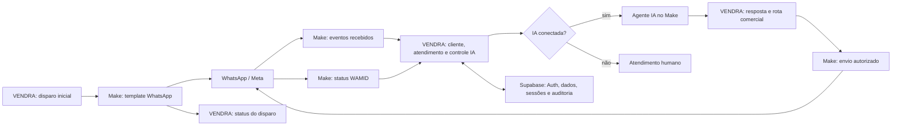

# Integrações Make e Supabase

## Cenários escolhidos pelo usuário

1. `VENDRA - Meta -> VENDRA -> IA -> WhatsApp + WAMID Statuses (REV9 v0.0.17)`.
2. `VENDRA | Disparo Inicial | WhatsApp Template | Normaliza telefone BR | v0.0.18 | DIAGNOSTICO sem variavel (espera 0)`.

Os blueprints originais permanecem nos anexos fora do checkout. Há valores de headers de autenticação nesses arquivos; esta documentação registra nomes e contratos sem copiar seus valores. Conexões do Make, hooks e agentes do blueprint não estabelecem acesso à conta nem atividade dos cenários.

## Fluxo observado

Este diagrama representa o contrato da aplicação principal e dos blueprints, não um fluxo atualmente conectado.

## Contratos HTTP

| Operação | Caminho no VENDRA | Dados/controle |
| --- | --- | --- |
| Mensagem recebida no webhook configurado | `POST /webhooks/configurados/{public_id}` | `phone`, `name`, `message`, `external_message_id`; header `X-Vendra-Webhook-Secret` |
| Alternativa legada de entrada | `POST /webhooks/make/whatsapp` | Mesmo corpo; header `X-Webhook-Secret` |
| Controle da conversa | `GET /webhooks/make/ai/control/{ticket_id}` | Conectado/desconectado, modo e versão de controle |
| Resposta da IA | `POST /webhooks/make/ai/reply` | `ticket_id`, `message`, `control_version`, `external_message_id`, `route_code`, `delivery_mode` |
| Confirmação de envio | `POST /webhooks/make/whatsapp/outbox/{outbox_id}/status` | `status`, `provider_message_id`, `error_message` opcional |
| Status do provedor | `POST /webhooks/make/whatsapp/provider-status` | WAMID, `sent/delivered/read/failed`, horário e destinatário |
| Resultado do disparo inicial | `POST /webhooks/make/disparos/{dispatch_id}/status` | `status`, `provider_message_id`, erro opcional |

Os endpoints `/make/...` exigem `X-Webhook-Secret`. O `GET /webhooks/make/whatsapp/outbox` faz claim da fila: não é uma consulta neutra e não deve ser usado como primeiro teste de conexão.

O blueprint REV9 recebe eventos Meta, envia entrada ao webhook configurado, consulta duas planilhas Google, usa o agente IA e divide respostas comerciais entre três ramos. Esses ramos usam `delivery_mode=inline_make`, registram a resposta no VENDRA, enviam pelo módulo WhatsApp e retornam WAMID/status. Devem ser conferidos os filtros de resposta suprimida/duplicada, handoff e versão do controle antes de qualquer teste de envio.

Os códigos comerciais do prompt são `#1` primeiro contato, `#2` conversa comercial e `#3` agendamento. O destino de funil/etapa é configurado no VENDRA; os códigos não devem ser confundidos com IDs de etapa ou prova de conversão.

O cenário de disparo possui webhook de entrada, normalização de telefone BR, módulo de template WhatsApp e callback de status. A versão enviada é de diagnóstico sem variável. É necessário confirmar template aprovado, idioma, remetente, campos esperados e destino antes de habilitá-lo.

O código trata idempotência, respostas suprimidas por mudança de controle, janela de atendimento WhatsApp e reconciliação de status que chega antes do vínculo do WAMID. Esses contratos têm de ser mantidos na configuração do Make.

## Supabase: identificação e acesso

Revalidação mais recente: a chave backend passou na leitura limitada pelo SDK, sem mudança de dados e com as filas reais vazias. Não solicitar novamente a chave nem criar bindings duplicados. O guard de STAGING ainda rejeita o formato das chaves proxy no runtime, embora elas funcionem no SDK; essa compatibilidade é um ajuste de código separado. Veja `VALIDACAO_ATUAL.md`. O erro 401 descrito abaixo é histórico.

Após publicação, as variáveis e bindings ficaram presentes. A chave pública alcança `/auth/v1/settings` com HTTP 200; a chave backend recebe `Invalid API key`/HTTP 401 ao ler `profiles`, tanto pelo SDK quanto pelo REST. Corrigir o binding existente antes de criar qualquer novo requisito. O módulo local de credenciais foi recuperado do Drive e a suíte local passou em 157 testes; ver `VALIDACAO_POS_PUBLICACAO.md`.

Projeto identificado na captura fornecida pelo usuário em 14/10/2026: **VENDRA-STAGING**, Reference ID `ljufhqnadzltqbtdaulv`, URL `https://ljufhqnadzltqbtdaulv.supabase.co`. A captura identifica o destino; não comprova acesso da máquina ao projeto. Uma requisição de leitura ao endpoint Auth nesta máquina foi bloqueada pelo proxy com HTTP 403, antes de autenticação.

Foram salvos no rascunho `SUPABASE_URL` e `VENDRA_STAGING_REF`, além dos requisitos seguros `SUPABASE_ANON_KEY` e `SUPABASE_SERVICE_ROLE_KEY`, restritos ao hostname desse projeto. Não foram fornecidos valores de chaves. O salvamento não aplica a configuração ao runtime nem publica o ambiente.

Abra o projeto **VENDRA-STAGING** no painel Supabase. Em **Settings → General**, procure o Reference ID; em **Settings → API** ou **Connect**, procure Project URL. O formato esperado é `https://<reference-id>.supabase.co`, sem `/rest/v1/`. Essa URL e esse ID podem ser informados no chat; chaves e senhas não.

Configuração requerida pelo código, ainda ausente nesta máquina:

| Nome | Uso |
| --- | --- |
| `SUPABASE_URL` | URL raiz do projeto selecionado |
| `VENDRA_STAGING_REF` | Guard do projeto de homologação |
| `SUPABASE_ANON_KEY` | Cliente de autenticação público |
| `SUPABASE_SERVICE_ROLE_KEY` | Cliente backend administrativo; nunca frontend |
| `SECRET_KEY` | Segredo local para controle da sessão/CSRF |
| `APP_ENV=staging` | Seleção de ambiente e cookie separado |
| `DEMO_MODE=false` | Dados reais somente no projeto confirmado |

Antes de pedir credenciais, verificar novamente os nomes/presença das variáveis e bindings nas configurações do ambiente; não imprimir valores. O runtime atual e o rascunho inspecionado não continham bindings Supabase/Make. As chaves serão fornecidas pelas configurações seguras do ambiente, após identificar o destino exato e confirmar a compatibilidade do SDK/guard com a injeção pelo proxy. Não criar `.env` com valores do chat.

O arquivo `.env.h1_005b2` é o caminho de configuração já suportado pelos scripts de STAGING. `tools.staging_setup` é interativo e requer os dados do projeto; não foi executado. O bootstrap de administrador grava no Supabase e não deve ser repetido em um projeto já inicializado.

## Ordem de retomada

1. Recuperar o módulo original ausente; validar imports, testes bloqueados e startup.
2. Usar o projeto STAGING identificado acima; aguardar os bindings seguros e a aplicação da configuração de rede, então testar novamente o destino exato.
3. Configurar credenciais pelo canal seguro e testar leitura restrita de schema/Auth, sem dump de dados ou chaves.
4. Comparar tabelas, RLS, grants e RPCs com o estado remoto; conferir PT409. Não executar em lote os arquivos SQL de origem ou candidatos.
5. Homologar login e CRM com dados de teste no projeto confirmado; registrar evidências.
6. Preparar um ambiente de integração apropriado e endereço HTTPS estável para o Make. O STAGING H1-005B9 atual bloqueia Make/Meta e não monta webhooks externos.
7. Conferir as conexões dos dois cenários selecionados e seus contratos em cópia/revisão; só então definir o teste funcional de mensageria e seu destino.

A integração ainda não foi realizada. Não há ferramentas autenticadas de Make ou Supabase disponíveis nesta sessão; acesso por API depende da configuração segura apropriada. Não foram disparados cenários, enviados WhatsApps, aplicadas migrations ou alterados dados remotos.
